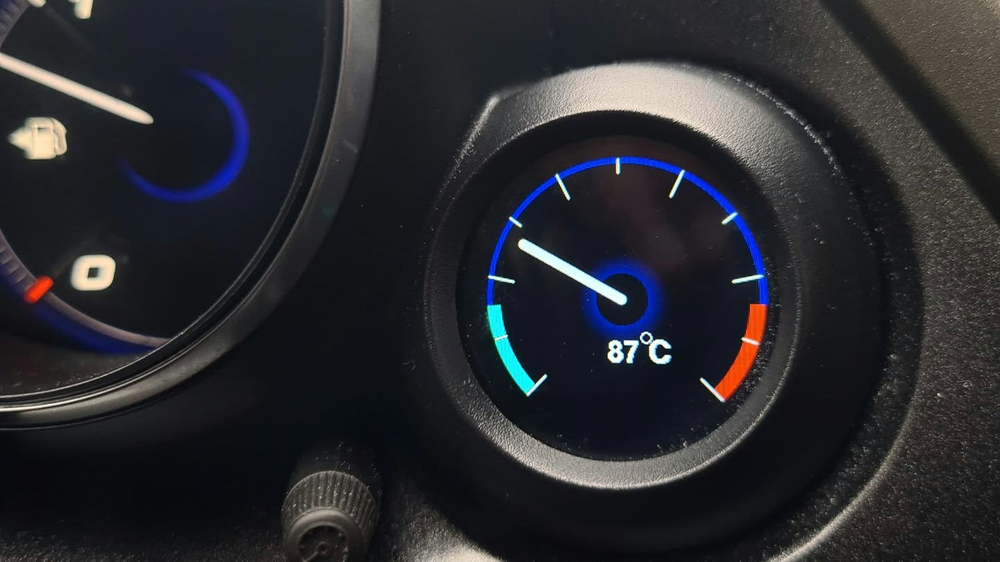

<!-- Improved compatibility of back to top link: See: https://github.com/othneildrew/Best-README-Template/pull/73 -->
<a id="readme-top"></a>
<!--
*** Thanks for checking out the Best-README-Template. If you have a suggestion
*** that would make this better, please fork the repo and create a pull request
*** or simply open an issue with the tag "enhancement".
*** Don't forget to give the project a star!
*** Thanks again! Now go create something AMAZING! :D
-->


<!-- PROJECT SHIELDS -->
<!--
*** I'm using markdown "reference style" links for readability.
*** Reference links are enclosed in brackets [ ] instead of parentheses ( ).
*** See the bottom of this document for the declaration of the reference variables
*** for contributors-url, forks-url, etc. This is an optional, concise syntax you may use.
*** https://www.markdownguide.org/basic-syntax/#reference-style-links
-->
[![Contributors][contributors-shield]][contributors-url]
[![Forks][forks-shield]][forks-url]
[![Stargazers][stars-shield]][stars-url]
[![Issues][issues-shield]][issues-url]
[![project_license][license-shield]][license-url]


<!-- PROJECT LOGO -->
<br />
<div align="center">
  <a href="https://github.com/Aperture-Shitpost-Innovators/ESPTempGauge">
    
  </a>

<h3 align="center">Aperture Shitpost Innovators Highly Modular Engine Lubrication Liquid Thermal Reading Apparatus</h3>

  <p align="center">
    ESP32-WROOM32 based oil temperature gauge with noise filtering, smooth movement and OTA updates.
    <br />
    <br />
    <br />
    <a href="https://github.com/Aperture-Shitpost-Innovators/ESPTempGauge/issues/new?labels=bug&template=bug-report---.md">Report Bug</a>
    &middot;
    <a href="https://github.com/Aperture-Shitpost-Innovators/ESPTempGauge/issues/new?labels=enhancement&template=feature-request---.md">Request Feature</a>
  </p>
</div>

# !!! THIS PAGE IS STILL UNDER CONSTRUCTION !!!
## Code itself works fine, but assembly instructions are incomplete!


<!-- TABLE OF CONTENTS -->
<details>
  <summary>Table of Contents</summary>
  <ol>
    <li>
      <a href="#about-the-project">About The Project</a>
      <ul>
        <li><a href="#built-with">Built With</a></li>
      </ul>
    </li>
    <li>
      <a href="#getting-started">Getting Started</a>
      <ul>
        <li><a href="#prerequisites">Prerequisites</a></li>
        <li><a href="#installation">Installation</a></li>
      </ul>
    </li>
    <li><a href="#roadmap">Roadmap</a></li>
    <li><a href="#contributing">Contributing</a></li>
    <li><a href="#license">License</a></li>
    <li><a href="#contact">Contact</a></li>
    <li><a href="#acknowledgments">Acknowledgments</a></li>
  </ol>
</details>


<!-- ABOUT THE PROJECT -->
## About The Project

<p align="center"> </p>

This is a customizable oil temperature gauge software repository. The default style was designed after the 9'th generation Honda Civic gauge cluster. This source code was designed to be compilable and uploadable onto an ESP32-WROOM32 out of the box using Visual Studio Code and PlatformIO.

<p align="right">(<a href="#readme-top">back to top</a>)</p>


### Built With

* [](https://code.visualstudio.com/)
* [](#)
* [](#)
* [](https://duplowiki.labalando.eu/Home/image-1756770655813.png)
  
<p align="right">(<a href="#readme-top">back to top</a>)</p>


<!-- GETTING STARTED -->
## Getting Started
Here are instructions on how to get the project up and running locally


### Hardware
#### Parts list:
* ESP32-WROOM-32E
* GC9A01A based 1.28" round display
* NTC Oil temperature of your choice
* USB - UART programmer, prefferably an FTDI FT232RL based one
* Custom ordered or manufactured PCB.
* Miscellanious parts listed below.

NOTE: PSRAM models of the ESP32 are preffered, lower memory models also work, however they cant fit the full screen into memory and thus it will show a 
black bar on the bottom of the screen. It's not visible in normal mode, but will show up during an alarm.
This is a hardware limitation.

#### Assembly
You will need to either manufacture or order a custom PCB for this project, either will work. I have provided a kicad project in the `hardware` folder if you wish to order one or modify my design.

### Software

### Prerequisites

This is an example of how to list things you need to use the software and how to install them.
* [Visual Studio Code](https://code.visualstudio.com/)
* [PlatformIO extension](https://platformio.org/install/ide?install=vscode)

### Installation
#### USB upload

1. Install prerequisites.
2. Clone the repo
   ```sh
   git clone https://github.com/Aperture-Shitpost-Innovators/ESPTempGauge.git
   ```
3. Do measurements of your sensor and input the Steinhart-Hart coefficients into the config variables.
4. (OPTIONAL) Configure the OTA wifi name and password.
5. Connect your ESP32 board and wire in the screen and sensors.
6. In Visual Studio Code's PlatformIO tab, click "Upload".

#### OTA Updates (Firmware needs to be flashed once before and OTA updates enabled!)

1. Make your changes and build the project.
2. Navigate into `.pio/build` and find the `firmware.bin` file.
3. Make a hotspot matching the WiFi name and password that were set in `include/wifi_passes.h`.
4. Start the ESP32. If it connects successfully, it should show `UPDATE MODE` on the screen.
5. Connect to the WiFi using your laptop and navigate to the ESP32's web page. By default, it is [http://esp32.local](http://esp32.local).
6. Select your new `firmware.bin` file and click "Upload".
7. Once it finishes and you see the gauge restart, stop your hotspot and power cycle it.

<p align="right">(<a href="#readme-top">back to top</a>)</p>

<!-- ROADMAP -->
## Roadmap

- [x] Usable oil gauge
- [ ] Proper documentation and instructions
- [ ] Refactored code
    - [ ] Easy to read code
    - [ ] Split into separate files
- [ ] Easily customizable user interface

See the [open issues](https://github.com/Aperture-Shitpost-Innovators/ESPTempGauge/issues) for a full list of proposed features (and known issues).

<p align="right">(<a href="#readme-top">back to top</a>)</p>


<!-- CONTRIBUTING -->
## Contributing

Contributions are what make the open source community such an amazing place to learn, inspire, and create. Any contributions you make are **greatly appreciated**.

If you have a suggestion that would make this better, please fork the repo and create a pull request. You can also simply open an issue with the tag "enhancement".
Don't forget to give the project a star! Thanks again!

1. Fork the Project
2. Create your Feature Branch (`git checkout -b feature/AmazingFeature`)
3. Commit your Changes (`git commit -m 'Add some AmazingFeature'`)
4. Push to the Branch (`git push origin feature/AmazingFeature`)
5. Open a Pull Request

<p align="right">(<a href="#readme-top">back to top</a>)</p>

### Top contributors:

<a href="https://github.com/Aperture-Shitpost-Innovators/ESPTempGauge/graphs/contributors">
  
</a>


<!-- LICENSE -->
## License

Distributed under the MIT license. See the `LICENSE` file for more information.

<p align="right">(<a href="#readme-top">back to top</a>)</p>


<!-- CONTACT -->
## Contact

Project Link: [https://github.com/Aperture-Shitpost-Innovators/ESPTempGauge](https://github.com/Aperture-Shitpost-Innovators/ESPTempGauge)

<p align="right">(<a href="#readme-top">back to top</a>)</p>


<!-- ACKNOWLEDGMENTS -->
## Acknowledgments

* [TFT_eSPI library](https://github.com/Bodmer/TFT_espi)
* [PNGdec library](https://github.com/bitbank2/PNGdec)
* [Simple Kalman Filter](https://github.com/denyssene/SimpleKalmanFilter)
* [This really cool README template](https://github.com/othneildrew/Best-README-Template)

<p align="right">(<a href="#readme-top">back to top</a>)</p>


<!-- MARKDOWN LINKS & IMAGES -->
<!-- https://www.markdownguide.org/basic-syntax/#reference-style-links -->
[contributors-shield]: https://img.shields.io/github/contributors/Aperture-Shitpost-Innovators/ESPTempGauge.svg?style=for-the-badge
[contributors-url]: https://github.com/Aperture-Shitpost-Innovators/ESPTempGauge/graphs/contributors
[forks-shield]: https://img.shields.io/github/forks/Aperture-Shitpost-Innovators/ESPTempGauge.svg?style=for-the-badge
[forks-url]: https://github.com/Aperture-Shitpost-Innovators/ESPTempGauge/network/members
[stars-shield]: https://img.shields.io/github/stars/Aperture-Shitpost-Innovators/ESPTempGauge.svg?style=for-the-badge
[stars-url]: https://github.com/Aperture-Shitpost-Innovators/ESPTempGauge/stargazers
[issues-shield]: https://img.shields.io/github/issues/Aperture-Shitpost-Innovators/ESPTempGauge.svg?style=for-the-badge
[issues-url]: https://github.com/Aperture-Shitpost-Innovators/ESPTempGauge/issues
[license-shield]: https://img.shields.io/github/license/Aperture-Shitpost-Innovators/ESPTempGauge.svg?style=for-the-badge
[license-url]: https://github.com/Aperture-Shitpost-Innovators/ESPTempGauge/blob/master/LICENSE
[linkedin-shield]: https://img.shields.io/badge/-LinkedIn-black.svg?style=for-the-badge&logo=linkedin&colorB=555
[linkedin-url]: https://linkedin.com/in/linkedin_username
[product-screenshot]: images/irl.png
